# Rock Paper Scissors Game Project Plan

## Metadata
| Key | Value |
| --- | --- |
| ID | PP-001 |
| CrossReference | [BC-001], [SA-001], [MIL-001], [MIL-002], [MIL-003], [ADR-0002] |
| Language | en |
| Domain | it |

## Version History
| Date | Status | Author | Reviewer | Change | Commit |
| --- | --- | --- | --- | --- | --- |
| 2026-11-15 | Deprecated | Claude (AI assistant) | S01 | Added gateway MIL-003 Wiki at S01's request; accepted after RC-012 (Go) | [4f0682a] |
| 2026-11-15 | Accepted | Claude (AI assistant) | S01 | Wiki deliverable now in English, Danish and Malay at S01's request; accepted after RC-015 (Go) | pending |

---

## Purpose

This plan schedules the two gateways that take the Rock Paper Scissors Game from
an accepted baseline to a first release. The Business Case ([BC-001]) sets no
deadline and no budget, so the window is a soft one that S01 set on
2026-11-15; a miss costs only time.

## Planning Assumptions

- The plan starts on 2026-11-15 and ends on 2026-11-16 (a one-day window set by
  S01; source: chat, 2026-11-15).
- There are three gateways, one per phase: the baseline documents, the first
  release, then the wiki. S01 added the wiki gateway in chat on 2026-11-15
  after the first release was delivered, and later asked for Danish and Malay
  editions on top of English; the wiki is a project document the
  framework describes, so it falls under the Business Case scope item "the
  project documents the framework requires" and needs no change to
  [BC-001].
- S01 is the only stakeholder ([SA-001]) and owns and approves every gateway.
- The game and its tests already exist from the course exercise; the first
  release brings them under review rather than building them again.
- No user stories or use cases are written, so tasks are plain technical tasks
  ([ADR-0002]).

## Gateway Schedule

| Gateway | Document | Window | Decision date | Owner | Stories | Main deliverable | Milestone |
| --- | --- | --- | --- | --- | --- | --- | --- |
| Baseline | [MIL-001] | 2026-11-15 | 2026-11-15 | S01 | none (technical tasks, [ADR-0002]) | Business Case, Stakeholder Analysis, Project Plan and the milestones accepted, with ADR-0001, ADR-0002 and the framework repository rules applied | [Milestone 1][MS-001] |
| First release | [MIL-002] | 2026-11-15 to 2026-11-16 | 2026-11-16 | S01 | none (technical tasks, [ADR-0002]) | The reviewed game, its tests and its README | [Milestone 2][MS-002] |
| Wiki | [MIL-003] | 2026-11-15 to 2026-11-16 | 2026-11-16 | S01 | none (technical tasks, [ADR-0002]) | The English, Danish and Malay wiki in `docs/wiki/`, reviewed and published | [Milestone 3][MS-003] |

```plantuml
@startgantt
Project starts 2026-11-15
[Baseline] starts 2026-11-15 and ends 2026-11-15
[Baseline Go/No-Go] happens 2026-11-15
[First release] starts 2026-11-15 and ends 2026-11-16
[First release Go/No-Go] happens 2026-11-16
[Wiki] starts 2026-11-15 and ends 2026-11-16
[Wiki Go/No-Go] happens 2026-11-16
@endgantt
```



## Scope Coverage

| Business Case scope item | Gateway |
| --- | --- |
| One command-line round with a player choice of 0, 1 or 2 | [MIL-002] |
| A random computer choice | [MIL-002] |
| Both choices as ASCII art, and the result | [MIL-002] |
| A message for invalid input | [MIL-002] |
| Automated tests for the game rules | [MIL-002] |
| The project documents the framework requires | [MIL-001], the README in [MIL-002], and the wiki in [MIL-003] |

## Dependencies

```
MIL-001 Baseline -> MIL-002 First release -> MIL-003 Wiki
```

MIL-002 cannot be decided before MIL-001 is `Accepted`, and MIL-003 not before
MIL-002. A No-Go on a gateway moves the later gateways and the end date by the
time it takes to fix the finding; a No-Go on MIL-003 moves only the end date. S01 decides any move of the end date.

## Plan Risks

| Risk | Impact | Mitigation |
| --- | --- | --- |
| The one-day window is too short for the code review and its fixes | The end date moves | S01 moves the end date; the code is small (about 130 lines) and already tested |
| Code review of the existing game finds more than a quick fix | MIL-002 gets a No-Go | Fix findings on the branch and review again; scope stays the narrowest release (from [BC-001] risk: the game code predates the plan) |
| The git host token is missing when the milestones are published | Issues are not created | The run stops and reports it; S01 supplies the token |
| The wiki is not enabled on the host, or the publish does not run | The wiki pages are not visible | The wiki is enabled on the host (checked 2026-11-15); the pages are checked on the published wiki after the merge |

## Open Issues

- No publish workflow is installed, so publishing the milestones to the git
  host needs `sync-project.sh --apply` and a token.

---

[BC-001]: ./business-case.md
[SA-001]: ./stakeholder-analysis.md
[MIL-001]: ./milestones/mil-001-baseline.md
[MIL-002]: ./milestones/mil-002-first-release.md
[MIL-003]: ./milestones/mil-003-wiki.md
[ADR-0002]: ./adr/adr-0002-skip-user-stories-and-use-cases.md
[MS-001]: https://git.tirsystem.com/Tirsvad-Udemy-100-days-of-code/004-rock-paper-scissors-game/milestone/499
[MS-002]: https://git.tirsystem.com/Tirsvad-Udemy-100-days-of-code/004-rock-paper-scissors-game/milestone/500
[d3c74f5]: https://git.tirsystem.com/Tirsvad-Udemy-100-days-of-code/004-rock-paper-scissors-game/commit/d3c74f56d4214003f20c8c78a96173b793e43a56
[1428c08]: https://git.tirsystem.com/Tirsvad-Udemy-100-days-of-code/004-rock-paper-scissors-game/commit/1428c081485708bd32faf83a277b5f47b43ef5c1
[MS-003]: https://git.tirsystem.com/Tirsvad-Udemy-100-days-of-code/004-rock-paper-scissors-game/milestone/501
[4f0682a]: https://git.tirsystem.com/Tirsvad-Udemy-100-days-of-code/004-rock-paper-scissors-game/commit/4f0682a2233d43d9da078d6dfcecf3cfcb2a1c84
